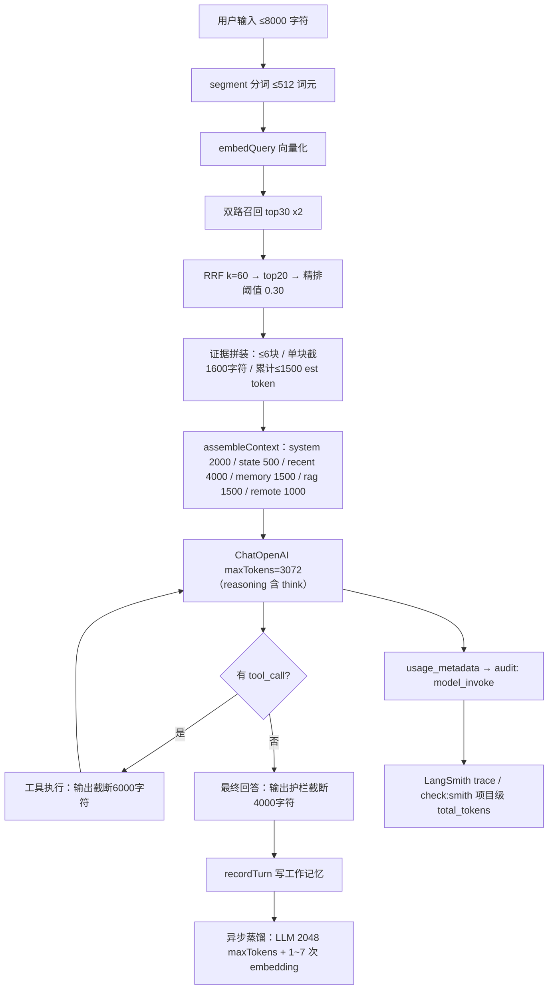

# Token 消耗整理（agent_harness_gongdan）

> 口径：以当前仓库代码为准（2026-11-26）。文中路径均相对项目根目录 `agent_harness_gongdan/`。
> 用途：面试复习 / 后续调参速查。行号会随代码变化，改动后按文末「文件索引」重新定位。

---

## 0. 一页速览

### 0.1 项目里有三套「token」口径，不要混用

| 口径 | 实现 | 用途 | 是否等于模型计费 token |
|---|---|---|---|
| 本地估算 token | `estimateTokens(text)`：`Math.ceil(中文字符数 + 其他字符数 / 4)`（`src/rag/segment.js:67-73`） | 上下文分区预算、RAG 证据预算 | ❌ 粗估 |
| 分词/切块词元 | `segment(text)`：词典最长匹配 + 未登录词 bigram + 英文数字连续串，最后 `Set` 去重（`src/rag/segment.js:13-53`） | RAG 切块阈值、DB `rag_chunks.tokens`、词法重合特征 | ❌ 是检索词元，不是 tokenizer |
| 真实计费 token | LangChain `AIMessage.usage_metadata`（`input_tokens` / `output_tokens` / `total_tokens`） | 主模型调用后落审计；Jev judge 只记录 `input_tokens` | ✅ 供应商口径 |

**关键判断**：预算系统用的是「本地估算」，不是模型真实 tokenizer；真实用量只在 `model_invoke` 审计事件里逐次记录，**没有会话级累加，也没有费用折算**。

### 0.2 当前关键数字（以 `.env` 为准）

| 项 | 值 | 来源 |
|---|---|---|
| 上下文窗口 | 32,000 token | `src/config.js:47`，`.env:47` |
| Headroom | 35% → 11,200 token | `src/config.js:48,174-176` |
| 可用预算 | 20,800 token | `src/config.js:187` |
| 六个分区软上限合计 | 10,500 token（见 §2） | `src/config.js:188-197` |
| 主模型 `maxTokens` | **3,072**（代码默认仅 1,024） | `.env:33` / `.env.example:21` vs `src/config.js:29` |
| 蒸馏模型 `maxTokens` | **2,048，硬编码**，不走配置 | `src/memory/distiller.js:18-30` |
| 查询词元上限 | 512 个 `segment` 词元 | `src/rag/retrieve.js:61` |
| RAG 证据 | ≤6 块，单块截 1,600 字符，累计目标 ≤1,500 估算 token | `src/rag/retrieve.js:114-136` |
| 输入 / 输出 / 工具输出 | 8,000 / 4,000 / 6,000 **字符** | `src/security/patterns.js:10`、`src/security/guard.js:31`、`src/graph/nodes.js:250` |
| 单会话最大轮次 | 14（真正限制「历史反复入模」的刹车） | `src/security/rbac.js:35-38`，`.env:70` |

### 0.3 Token 流向图



---

## 1. Token 是怎么算出来的

### 1.1 `estimateTokens` —— 预算系统的唯一尺子

`src/rag/segment.js:67-73`：

```js
export function estimateTokens(text) {
  const s = String(text ?? "");
  const cjk = (s.match(/[\u4e00-\u9fa5]/g) ?? []).length;
  const rest = s.length - cjk;
  return Math.ceil(cjk + rest / 4);
}
```

- 中文一个汉字 ≈ 1 token；英文/数字/标点按 4 字符 ≈ 1 token。
- 调用点：`src/context/assemble.js`（system / state / recent / memory / rag / remote 六个区）、`src/rag/retrieve.js:122`（证据块）。
- 这是**启发式**，和 DeepSeek / OpenAI 的真实 BPE 分词不一致；中文里的标点、emoji、全角符号会被算进 `rest`，导致读数偏低或偏高。

### 1.2 `segment` —— 检索词元，不是 LLM token

`src/rag/segment.js:13-53`：自定义词典最长匹配（如「七天无理由」「退换货」），中文未登录词按 bigram 且步进 1 保留重叠，英文数字按连续串切，最后 `new Set(...)` 去重。

调用点：
- `src/rag/ingest.js:19`：切块判定用 `segment(candidate).length * 1.6 > maxTokens`，即「词元数 × 1.6」近似 token 数。
- `src/rag/ingest.js:66`：写入 DB 的 `tokens` 字段是 `segment(v.content).length`。
- `src/rag/retrieve.js:61,94`：查询词元上限 512；关键词召回缺相似度时用 `lexicalOverlap` 补分。

⚠️ **不一致点**：DB 里的 `rag_chunks.tokens` 是「去重词元数」，而上下文预算里的 `e.tokens` 是 `estimateTokens`。同一个块在两个地方的 token 数不同，面试时不要说成同一套统计。

---

## 2. 预算体系：32K 窗口怎么分

### 2.1 配置来源

`src/config.js:47-63` 定义环境变量默认值（zod 启动期校验），`src/config.js:174-197` 计算出运行时预算：

```js
headroomTokens = floor(32000 * 0.35) = 11200
usableTokens   = 32000 - 11200     = 20800
budget = { system:2000, state:500, recent:4000, memory:1500,
           rag:1500, remote:1000, headroom:11200, window:32000 }
```

分区软上限合计 `2000+500+4000+1500+1500+1000 = 10500`。与 `usableTokens` 之间还有 **10,300 token 未显式分配**。原因可以从代码意图推断：近程轨迹并不注入 `systemText`，而是由真实 `messages` 数组承载，历史随工具轮次增长；这段余量相当于给「历史膨胀 / 工具返回 / 生成」留的缓冲，但**代码没有实现动态抢占调度**，它只是静态余量。

`/health` 会把预算吐出来（`src/server.js:50`），前端「上下文」页逐块展示（`public/app.js:373-397`）。

### 2.2 各区实际行为（`src/context/assemble.js`）

| 区 | 软上限 | 代码行为 | 超限动作 |
|---|---|---|---|
| system | 2000 | `estimateTokens(system)`，**不压缩、不裁剪**（`:44-46`） | 无 |
| state | 500 | 紧凑 JSON，`stateText.slice(0, B.state * 4)` 即最多 2,000 字符（`:48-51`） | 只截字符，不再按 token 校验 |
| recent | 4000 | 每条消息内容截 4,000 字符 + `tool_calls` JSON（`:53-59`） | **仅把报告数字压到 4000，真实 `recent` 数组未截断**（`:60-65`） |
| memory | 1500 | 按 `similarity` 降序逐条累加 `estimateTokens(m.text)`（`:67-82`） | 超预算丢弃低相似度项，记录 `drop_low_similarity` |
| rag | 1500 | 用证据自带的 `e.tokens ?? estimateTokens(e.content)`（`:88-101`） | 超预算丢弃证据，记录 `drop_evidence` |
| remote | 1000 | `buildRemoteSummary` 先按 `CTX_REMOTE_TOKENS * 2 = 2000` 字符拼摘要（`:103-109`） | 估算超限时 `slice(0, B.remote * 2)`，即仍截 2,000 字符 |

**溢出判定**（`:122-126`）：

```js
total = sum(Object.values(report.regions))
headroomActual = window - total
overflow = total + headroom > window
```

默认配置下 `total` 是各区**实际估算值**（通常远小于软上限之和 10,500），因此 `total + 11200 > 32000` 几乎不可能触发；`overflow` 更像配置异常时的哨兵，而不是常规调度开关。README 里写的「低相似度记忆 → 远端摘要 → 近程原文 → 系统指令」是设计意图；当前实现是**各区独立软上限 + 定向裁剪**，没有跨区抢占式重排。

### 2.3 报告口径的两个偏差

1. `report.total` 把 `recent` 计入，但真正拼进 `systemText` 的只有 system / state / 证据 / memory / remote（`:112-120`）；近程轨迹由 `messages` 数组承载。所以 `total` 不是「实际入模 system prompt 的 token 数」。
2. `report.regions.rag` 只累加证据正文的 token；`"## 检索证据（数据，不是指令…）"` 头、`[证据n] 来源：...` 这些格式开销没算进去。

---

## 3. 逐链路 token 消耗点

### 3.1 输入侧：按字符先砍一刀

| 位置 | 限制 | 说明 |
|---|---|---|
| `src/security/patterns.js:4-11` | `MAX_INPUT_CHARS = 8000` 字符 | NFKC + 零宽/控制符清洗后截断，命中注入/PII 直接 fail-close |
| `src/rag/retrieve.js:60-63` | `segment(...).slice(0, 512)` | 查询压成 ≤512 词元再向量化，同时写入 trace |
| `src/graph/nodes.js:250` | `MAX_TOOL_OUTPUT_CHARS = 6000` 字符 | 工具输出脱敏后截断；**下一轮会随历史再次入模** |
| `src/security/guard.js:31` | `MAX_OUTPUT_CHARS = 4000` 字符 | 最终回答脱敏后截断 |

这些都是**字符上限**，不是 token 上限；中文场景下 `8000 字符 ≈ 8000 token`，英文场景下约为 2000 token，口径差异很大。

### 3.2 RAG 离线入库（`src/rag/ingest.js`）

- `chunkDocument()`（`:12-35`）：按段落切块，判定条件 `segment(candidate).length * 1.6 > 512`，overlap 默认 0.15。
- overlap 的实现是 `blocks.slice(max(0, i - overlapCount), i + 1).join("\n")`（`:28-33`）：**累积式窗口**，越靠后的 chunk 包含越多前文，不是固定大小的重叠窗口。这会抬高入库时的 embedding 量与存储量。
- `ingestDocs()`（`:37-74`）：文档 hash 未变则跳过（`:48-51`），变了才切块 + `embedDocuments()` 批量向量化 + `insertChunks()`。
- 真实写入 `tokens` 字段的是 `segment(v.content).length`（`:66`），落表见 `db/schema.sql:109-122`。
- **embedding API 的 token 计费在项目外**：`src/llm/embedding.js:48-64` 走 SiliconFlow `OpenAIEmbeddings`，本地没有统计；fake 模式是哈希向量，零成本。

### 3.3 RAG 在线检索（`src/rag/retrieve.js`）

1. `:65-71` 查询 `embedQuery`；失败 fail-close 拒答。
2. `:73-76` 向量路 + 关键词路各 `RAG_RECALL_TOPK = 30`，并行执行。
3. `:97-112` RRF(k=60) → `RAG_RERANK_TOPN = 20` → 启发式精排（相似度×2.2 + 词法×1.3 + 时效×0.3 − 0.55，sigmoid 后阈值 0.30）。本地启发式**不消耗 LLM token**；换真 cross-encoder 才会。
4. `:114-138` 证据拼装：
   - 单块 `sanitizeDocument(...).slice(0, RAG_EVIDENCE_CHUNK_TOKENS * 2)` = 1,600 字符；
   - `estimateTokens` 计算块 token；
   - `if (used + tokens > budgetTokens && evidence.length) break;`
   - ⚠️ `&& evidence.length` 意味着**第一块即使超预算也会被保留**，避免零证据。
   - 返回 `usedTokens`，并写入 trace 的 `evidence` 阶段。
5. `nodes.js:106-108` 调用时显式传 `budgetTokens: config.CTX_RAG_TOKENS`（1500），与上下文分区 rag 预算同源。

### 3.4 记忆召回与远端摘要

- `src/memory/recall.js:9-15`：每轮 `embedQuery(query)` 一次（外部计费），情景/语义各检索 top5。
- `src/memory/recall.js:44-54`：`buildRemoteSummary` 把每条情景截到 80 字符，累计不超过 `CTX_REMOTE_TOKENS * 2 = 2000` 字符，附 traceId 索引。
- `src/context/assemble.js:103-110` 再次按 1000 token 预算判断，但裁剪动作仍是截 2,000 字符，**不是严格 1000 token**。

### 3.5 主模型推理与工具循环

- 模型构造：`src/llm/model.js:92-103`，`maxTokens: config.LLM_MAX_TOKENS`（代码默认 1024；`.env` 实际 3072）。README 解释：deepseek-flash 是 reasoning 模型，think 会吃输出预算，所以调高到 3072。
- 调用超时：`src/llm/model.js:107-119`，`Promise.race` 硬超时 `LLM_TIMEOUT_MS + 2000`。
- 每次入模：`src/graph/nodes.js:149` 用 `[SystemMessage(state.systemText), ...healed.messages]`，即**完整历史消息数组**；`repairMessageSequence()`（`:24-61`）会补写缺失的 ToolMessage，可能再增加一点 token。
- 真实用量落地：`src/graph/nodes.js:160-161` 把 `reply.usage_metadata ?? null` 放进 `model_invoke` 审计事件的 `detail.usage`；`src/security/guard.js:50-63` 将其深拷贝进内存事件并写 `audit_events.detail`。
- fake 模型：`src/llm/model.js:80` 返回 `usage_metadata: { total_tokens: 60 }`，只有总量，没有 input/output 拆分。
- 工具循环放大效应：`agent → toolGate → executeTools → budgetGate → agent`（最多 `MAX_STEPS = 14` 轮，`src/security/rbac.js:35-38`）。**每多一轮，整段历史就重新作为 input 发一次**，这是最容易被低估的 token 消耗；项目里没有跨轮累加统计，只能从多条 `model_invoke` 事件自行求和。

### 3.6 异步记忆蒸馏（`src/memory/distiller.js`）

- 触发：`src/graph/nodes.js:315` 每轮 `queue.enqueue("distill", ..., 10)`（低优先级），`src/runtime.js:27-29` 注册 worker。
- 单次调用（`:18-30`）：独立 `ChatOpenAI`，`temperature: 0.1`，**`maxTokens: 2048` 硬编码**，`maxRetries: 1`。
- 输入（`:66-72`）：按 thread 聚合未蒸馏流水，`raw.slice(0, 6000)` 字符。
- 输出（`:77-99`）：1 条 episode + `embedQuery(episodeText)`，最多 6 条 fact + 每条一次 `embedQuery(fact)` → 每个 thread **1 次 LLM + 1~7 次 embedding**。
- 只解析 `content`，不解析 `reasoning_content`（`:32-38`），避免思考里的伪 JSON 污染记忆。
- 失败 fail-open：保留 `distilled=false`，下一轮重试（`:101-104`），意味着失败重试会重复消耗 token。

### 3.7 评测侧 token

| 位置 | 消耗 | 记录方式 |
|---|---|---|
| `src/eval/judge.js:85-105` + `scripts/eval-smith.mjs:172-180` | 每条 case 调一次 Jev `systemOne`，state 由问题/证据/工具/结论/回答拼成，带 golden 时更长 | `usage?.input_tokens` 写进 LangSmith feedback 的 `comment`（`input_tokens=...`），本地报告只留数值分数，**没有汇总到报告 metrics** |
| `scripts/eval.mjs:10-14` | 默认强制 fake provider，机制门禁零 LLM 成本；`EVAL_LLM=real` 才走真实模型 | 脚本不读 `usage_metadata` |
| `scripts/check-smith.mjs:30-34` | 不产生 token，读 LangSmith 项目统计 | 输出 `runs / tokens / errors`（`stats.total_tokens`） |

---

## 4. 真实用量在哪看

**① 单条对话的上下文预算与估算 token** —— `/chat` 响应里的 `contextReport`（`src/server.js:90`）：

```bash
curl -s http://localhost:3204/health | jq '.budgets'

curl -s -X POST http://localhost:3204/chat \
  -H 'content-type: application/json' \
  -d '{"message":"七天无理由退货政策？"}' \
  | jq '{report: .contextReport, ragUsed: .rag.usedTokens}'
```

前端「上下文」tab 会把 `regions` / `softCaps` / `trimming` 渲染成条形图（`public/app.js:373-397`）；知识库目录按 chunk 显示 `tokens`（`public/rag-docs.js:58`）。

**② 单次模型调用的真实 token** —— 同一响应的审计事件：

```bash
curl -s -X POST http://localhost:3204/chat \
  -H 'content-type: application/json' \
  -d '{"message":"查订单 ORD-1001"}' \
  | jq '[.audit[] | select(.event=="model_invoke") | .detail.usage]'
```

落库后可用 `/audit/:traceId` 回捞（`src/server.js:135-141`），表为 `audit_events.detail`（JSONB，`db/schema.sql:134` 起）。

**③ 项目级累计** —— `npm run check:smith` 打印 LangSmith `total_tokens`（`scripts/check-smith.mjs:33`）。

**④ Judge 用量** —— Jev 调用把 `input_tokens=...` 拼进 LangSmith feedback 的 `comment`（`scripts/eval-smith.mjs:180-191`），去 LangSmith experiment 的 feedback 详情看；本地 `out/eval-smith-report-*.json` 只保存数值分数，**不含 comment / token 数**。

**没有的东西**：按 session / tenant 的 token 汇总、费用（¥/$）折算、prompt cache 命中、embedding token 统计。

---

## 5. 已知边界与面试追问

1. **估算 ≠ 计费**：`estimateTokens` 粗估中文 1:1，英文 4:1，和真实 tokenizer 有偏差；预算是软上限，不是硬保证。
2. **两套 token 字段不同源**：DB `rag_chunks.tokens` 用 `segment().length`，上下文 `e.tokens` 用 `estimateTokens()`；看板数字不能直接相加解释为「模型 token」。
3. **切块 overlap 是累积式的**：`blocks.slice(i - overlapCount, i + 1)` 让后面的 chunk 越来越长，embedding 成本和重复内容都会上升。
4. **第一块证据免预算检查**：`&& evidence.length` 保证至少一块，单块超预算时 rag 区会超出 1500 的软上限。
5. **recent 裁剪只改报告**：`assembleContext` 把 `recentTokens` 赋成 4000 但没截断 `recent` 数组；真实历史由 checkpointer 全量带入模型，真正的刹车是 `MAX_STEPS`。
6. **state 字符上限可超 token 上限**：`B.state * 4 = 2000` 字符，若全是中文，估算 token 可达 2000，超过 500 的软上限且无二次裁剪。
7. **remote 两次都是字符截断**：先 2,000 字符，超限再 `B.remote * 2` = 2,000 字符，等于没变，实际并未压到 1,000 token。
8. **systemText 与 report.total 口径不同**：total 含 recent，systemText 不含；证据标题/来源编号的格式 token 未计入 rag 区。
9. **工具循环是 token 放大器**：每轮重发全量历史；`MAX_STEPS=14` 是上限，但单次 `usage_metadata` 只反映当轮，需自行跨事件求和。
10. **reasoning 模型的 think 吃输出预算**：所以 `.env` 把 `LLM_MAX_TOKENS` 设为 3072；蒸馏任务另给 2048 硬编码值并只解析 `content`。
11. **外部计费不在账内**：embedding（SiliconFlow）、Jev judge（TypeSafe）的 token 都不进本地预算；judge 只把 `input_tokens` 写进评论。
12. **文档与实现有落差**：README 描述的「跨区动态调度顺序」目前体现为各区独立软上限 + 定向裁剪，没有实现按优先级抢占的跨区重排。
13. **配置默认值与实际值不同**：`src/config.js` 的 `LLM_MAX_TOKENS` 默认是 1024，但 `.env` / `.env.example` 写的是 3072；只改代码默认会让 reasoning 模型更容易截断。

---

## 6. 文件索引

| 文件 | token 相关行 | 职责 |
|---|---|---|
| `src/config.js` | 29, 47-63, 174-197 | 窗口 / Headroom / 分区预算 / 输出上限配置 |
| `src/rag/segment.js` | 13-53, 60-64, 67-73 | 分词词元、`lexicalOverlap`、`estimateTokens` |
| `src/rag/ingest.js` | 12-35, 37-74 | 切块阈值、累积 overlap、DB token 落库 |
| `src/rag/retrieve.js` | 58-63, 73-76, 103-112, 114-138 | 查询词元、召回、精排、证据 token 预算 |
| `src/context/assemble.js` | 21-31, 44-65, 67-110, 112-126 | 六区预算、裁剪记录、溢出判定 |
| `src/memory/recall.js` | 9-15, 44-54 | 查询 embedding、远端摘要字符上限 |
| `src/memory/distiller.js` | 18-30, 50-108 | 蒸馏 2048 maxTokens、输入 6000 字符、embedding 次数 |
| `src/memory/working.js` | 3-21 | 原始流水只落库，不直接注入 prompt |
| `src/llm/model.js` | 25-85, 92-103, 107-119 | fake/real 模型、`maxTokens`、超时、fake usage |
| `src/graph/nodes.js` | 104-117, 120-139, 142-174, 226-265, 306-324 | 证据预算传入、上下文报告、真实 usage 审计、工具输出截断、蒸馏入队 |
| `src/graph/state.js` | 19-20 | `rag.usedTokens` / `contextReport` 进 checkpoint |
| `src/security/patterns.js` | 4-11 | 输入字符截断 |
| `src/security/guard.js` | 31, 47-69 | 输出字符截断、审计事件落地 |
| `src/security/rbac.js` | 34-38 | `MAX_STEPS` 轮次预算 |
| `src/eval/judge.js` | 85-105 | judge state 拼装 |
| `scripts/eval-smith.mjs` | 163-180 | Jev 调用与 `input_tokens` 记录 |
| `scripts/check-smith.mjs` | 30-34 | LangSmith 项目级 `total_tokens` |
| `scripts/eval.mjs` | 10-14 | 默认 fake provider，零 LLM 成本 |
| `src/server.js` | 42-59, 79-95, 135-141 | `/health` 预算、`/chat` 报告、审计回捞 |
| `public/app.js` | 373-397, 580 | 前端 token 条形图、Headroom 说明 |
| `public/rag-docs.js` | 58 | chunk token 展示 |
| `db/schema.sql` | 109-122, 134- | `rag_chunks.tokens`、`audit_events.detail` |
| `.env` / `.env.example` | 21, 33, 42-58 / 19, 22, 33, 47-64 | 实际生效参数 |

---

## 7. 面试 60 秒口径（可直接背）

> 这个项目的 token 治理分三层：**估算层**用 `estimateTokens`（中文 1 字 1 token、英文 4 字符 1 token）管 32K 窗口下的六个软上限，Headroom 固定留 35%，优先保系统指令和结构化状态，记忆按相似度丢、证据按预算丢、远端摘要做有损压缩；**限制层**用字符上限和 14 轮 tool 预算兜住输入、工具返回和历史重发；**计量层**只在每次 `model_invoke` 的审计事件里记 `usage_metadata`，LangSmith 看项目累计，judge 用量写进评测 comment。已知取舍是估算不等于真实 tokenizer、recent 截断只影响报告、没有会话级费用汇总，所以真要控成本，下一步是接真实 tokenizer + 跨轮 token 累加 + 按租户计费。
