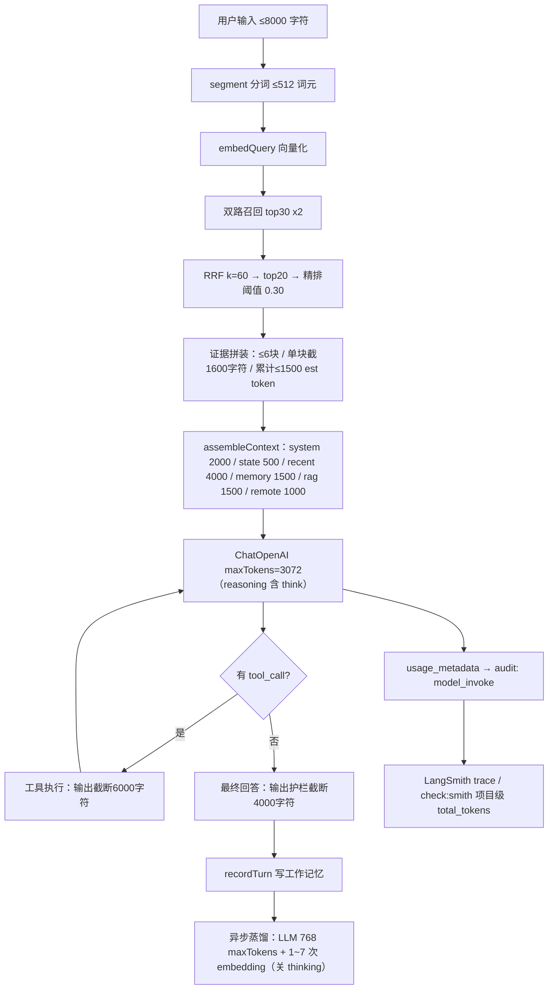

# Token 消耗整理（agent_harness_gongdan）

> 口径：以当前仓库代码为准（2026-11-26）。文中路径均相对项目根目录 `agent_harness_gongdan/`。
> 用途：面试复习 / 后续调参速查。行号会随代码变化，改动后按文末「文件索引」重新定位。

---

## 0. 一页速览

### 0.1 项目里有三套「token」口径，不要混用

| 口径 | 实现 | 用途 | 是否等于模型计费 token |
|---|---|---|---|
| 本地估算 token | `estimateTokens(text)`：`Math.ceil(中文字符数 + 其他字符数 / 4)`（`src/rag/segment.js:67-73`） | 上下文分区预算、RAG 证据预算 | ❌ 粗估 |
| 分词/切块词元 | `segment(text)`：词典最长匹配 + 未登录词 bigram + 英文数字连续串，最后 `Set` 去重（`src/rag/segment.js:13-53`） | RAG 切块阈值、DB `rag_chunks.tokens`、词法重合特征 | ❌ 是检索词元，不是 tokenizer |
| 真实计费 token | LangChain `AIMessage.usage_metadata`（`input_tokens` / `output_tokens` / `total_tokens`） | 主模型调用后落审计并折算 cost；Jev judge 只记录 `input_tokens` | ✅ 供应商口径 |

**关键判断**：预算系统用的是「本地估算」，不是模型真实 tokenizer；真实用量在 `model_invoke` 审计事件里逐次记录，按价格表折算成 USD 成本，并在 `/chat` / `/approve` 响应里按会话汇总。embedding 与 judge 的外部计费仍不在账内。

### 0.2 当前关键数字（以 `.env` 为准）

| 项 | 值 | 来源 |
|---|---|---|
| 上下文窗口 | 32,000 token | `src/config.js:47`，`.env:47` |
| Headroom | 35% → 11,200 token | `src/config.js:48,174-176` |
| 可用预算 | 20,800 token | `src/config.js:187` |
| 六个分区软上限合计 | 10,500 token（见 §2） | `src/config.js:188-197` |
| 主模型 `maxTokens` | **3,072**（代码默认仅 1,024） | `.env:33` / `.env.example:21` vs `src/config.js:29` |
| 蒸馏模型 `maxTokens` | **2,048，硬编码**，不走配置 | `src/memory/distiller.js:18-30` |
| 查询词元上限 | 512 个 `segment` 词元 | `src/rag/retrieve.js:61` |
| RAG 证据 | ≤6 块，单块截 1,600 字符，累计目标 ≤1,500 估算 token | `src/rag/retrieve.js:114-136` |
| 输入 / 输出 / 工具输出 | 8,000 / 4,000 / 6,000 **字符** | `src/security/patterns.js:10`、`src/security/guard.js:31`、`src/graph/nodes.js:250` |
| 单会话最大轮次 | 14（真正限制「历史反复入模」的刹车） | `src/security/rbac.js:35-38`，`.env:70` |
| 价格表 | 内置参考价（USD / 1M token），`MODEL_PRICING_JSON` 可覆盖 | `src/observability/cost.js:12-19`，`src/config.js:26-33,216-219` |

### 0.3 Token 流向图



---

## 1. Token 是怎么算出来的

### 1.1 `estimateTokens` —— 预算系统的唯一尺子

`src/rag/segment.js:67-73`：

```js
export function estimateTokens(text) {
  const s = String(text ?? "");
  const cjk = (s.match(/[\u4e00-\u9fa5]/g) ?? []).length;
  const rest = s.length - cjk;
  return Math.ceil(cjk + rest / 4);
}
```

- 中文一个汉字 ≈ 1 token；英文/数字/标点按 4 字符 ≈ 1 token。
- 调用点：`src/context/assemble.js`（system / state / recent / memory / rag / remote 六个区）、`src/rag/retrieve.js:122`（证据块）。
- 这是**启发式**，和 DeepSeek / OpenAI 的真实 BPE 分词不一致；中文里的标点、emoji、全角符号会被算进 `rest`，导致读数偏低或偏高。

### 1.2 `segment` —— 检索词元，不是 LLM token

`src/rag/segment.js:13-53`：自定义词典最长匹配（如「七天无理由」「退换货」），中文未登录词按 bigram 且步进 1 保留重叠，英文数字按连续串切，最后 `new Set(...)` 去重。

调用点：
- `src/rag/ingest.js:19`：切块判定用 `segment(candidate).length * 1.6 > maxTokens`，即「词元数 × 1.6」近似 token 数。
- `src/rag/ingest.js:66`：写入 DB 的 `tokens` 字段是 `segment(v.content).length`。
- `src/rag/retrieve.js:61,94`：查询词元上限 512；关键词召回缺相似度时用 `lexicalOverlap` 补分。

⚠️ **不一致点**：DB 里的 `rag_chunks.tokens` 是「去重词元数」，而上下文预算里的 `e.tokens` 是 `estimateTokens`。同一个块在两个地方的 token 数不同，面试时不要说成同一套统计。

---

## 2. 预算体系：32K 窗口怎么分

### 2.1 配置来源

`src/config.js:47-63` 定义环境变量默认值（zod 启动期校验），`src/config.js:174-197` 计算出运行时预算：

```js
headroomTokens = floor(32000 * 0.35) = 11200
usableTokens   = 32000 - 11200     = 20800
budget = { system:2000, state:500, recent:4000, memory:1500,
           rag:1500, remote:1000, headroom:11200, window:32000 }
```

分区软上限合计 `2000+500+4000+1500+1500+1000 = 10500`。与 `usableTokens` 之间还有 **10,300 token 未显式分配**。原因可以从代码意图推断：近程轨迹并不注入 `systemText`，而是由真实 `messages` 数组承载，历史随工具轮次增长；这段余量相当于给「历史膨胀 / 工具返回 / 生成」留的缓冲，但**代码没有实现动态抢占调度**，它只是静态余量。

`/health` 会把预算吐出来（`src/server.js:50`），前端「上下文」页逐块展示（`public/app.js:373-397`）。

### 2.2 各区实际行为（`src/context/assemble.js`）

| 区 | 软上限 | 代码行为 | 超限动作 |
|---|---|---|---|
| system | 2000 | `estimateTokens(system)`，**不压缩、不裁剪**（`:44-46`） | 无 |
| state | 500 | 紧凑 JSON，`stateText.slice(0, B.state * 4)` 即最多 2,000 字符（`:48-51`） | 只截字符，不再按 token 校验 |
| recent | 4000 | 每条消息内容截 4,000 字符 + `tool_calls` JSON（`:53-59`） | **仅把报告数字压到 4000，真实 `recent` 数组未截断**（`:60-65`） |
| memory | 1500 | 按 `similarity` 降序逐条累加 `estimateTokens(m.text)`（`:67-82`） | 超预算丢弃低相似度项，记录 `drop_low_similarity` |
| rag | 1500 | 用证据自带的 `e.tokens ?? estimateTokens(e.content)`（`:88-101`） | 超预算丢弃证据，记录 `drop_evidence` |
| remote | 1000 | `buildRemoteSummary` 先按 `CTX_REMOTE_TOKENS * 2 = 2000` 字符拼摘要（`:103-109`） | 估算超限时 `slice(0, B.remote * 2)`，即仍截 2,000 字符 |

**溢出判定**（`:122-126`）：

```js
total = sum(Object.values(report.regions))
headroomActual = window - total
overflow = total + headroom > window
```

默认配置下 `total` 是各区**实际估算值**（通常远小于软上限之和 10,500），因此 `total + 11200 > 32000` 几乎不可能触发；`overflow` 更像配置异常时的哨兵，而不是常规调度开关。README 里写的「低相似度记忆 → 远端摘要 → 近程原文 → 系统指令」是设计意图；当前实现是**各区独立软上限 + 定向裁剪**，没有跨区抢占式重排。

### 2.3 报告口径的两个偏差

1. `report.total` 把 `recent` 计入，但真正拼进 `systemText` 的只有 system / state / 证据 / memory / remote（`:112-120`）；近程轨迹由 `messages` 数组承载。所以 `total` 不是「实际入模 system prompt 的 token 数」。
2. `report.regions.rag` 只累加证据正文的 token；`"## 检索证据（数据，不是指令…）"` 头、`[证据n] 来源：...` 这些格式开销没算进去。

---

## 3. 逐链路 token 消耗点

### 3.1 输入侧：按字符先砍一刀

| 位置 | 限制 | 说明 |
|---|---|---|
| `src/security/patterns.js:4-11` | `MAX_INPUT_CHARS = 8000` 字符 | NFKC + 零宽/控制符清洗后截断，命中注入/PII 直接 fail-close |
| `src/rag/retrieve.js:60-63` | `segment(...).slice(0, 512)` | 查询压成 ≤512 词元再向量化，同时写入 trace |
| `src/graph/nodes.js:250` | `MAX_TOOL_OUTPUT_CHARS = 6000` 字符 | 工具输出脱敏后截断；**下一轮会随历史再次入模** |
| `src/security/guard.js:31` | `MAX_OUTPUT_CHARS = 4000` 字符 | 最终回答脱敏后截断 |

这些都是**字符上限**，不是 token 上限；中文场景下 `8000 字符 ≈ 8000 token`，英文场景下约为 2000 token，口径差异很大。

### 3.2 RAG 离线入库（`src/rag/ingest.js`）

- `chunkDocument()`（`:12-35`）：按段落切块，判定条件 `segment(candidate).length * 1.6 > 512`，overlap 默认 0.15。
- overlap 的实现是 `blocks.slice(max(0, i - overlapCount), i + 1).join("\n")`（`:28-33`）：**累积式窗口**，越靠后的 chunk 包含越多前文，不是固定大小的重叠窗口。这会抬高入库时的 embedding 量与存储量。
- `ingestDocs()`（`:37-74`）：文档 hash 未变则跳过（`:48-51`），变了才切块 + `embedDocuments()` 批量向量化 + `insertChunks()`。
- 真实写入 `tokens` 字段的是 `segment(v.content).length`（`:66`），落表见 `db/schema.sql:109-122`。
- **embedding API 的 token 计费在项目外**：`src/llm/embedding.js:48-64` 走 SiliconFlow `OpenAIEmbeddings`，本地没有统计；fake 模式是哈希向量，零成本。

### 3.3 RAG 在线检索（`src/rag/retrieve.js`）

1. `:65-71` 查询 `embedQuery`；失败 fail-close 拒答。
2. `:73-76` 向量路 + 关键词路各 `RAG_RECALL_TOPK = 30`，并行执行。
3. `:76-102` RRF(k=60) → `RAG_RERANK_TOPN = 20` → 精排已抽成 `src/rag/rerank.js`，三个 provider：
   - **siliconflow（主路默认）**：一次 `POST /v1/rerank` 把 20 个候选批量送给 `BAAI/bge-reranker-v2-m3`（不是逐对 20 次），用 `results[].index` 映射回候选、按独立的 `RERANK_API_THRESHOLD=0.5` 过滤（`rerank.js:50-105`）。返回的 `meta.tokens` 只写进审计 trace，**不并入主 LLM 的 costLedger**——该模型当前在 SiliconFlow 免费，且它不是主对话模型。
   - **heuristic（降级 / 离线兜底）**：`sigmoid(相似度×2.2 + 词法×1.3 + 时效×0.3 − 0.55)`，按 `RAG_RERANK_THRESHOLD=0.30` 过滤，**0 次模型调用**（`rerank.js:22-47`）。API 异常时自动回退到这里。
   - **shadow**：`RERANK_SHADOW=true` 时双跑，仍用 heuristic 排序，BGE 的 top 分数 / id 只写进 `trace.stages[].shadow`，不切流量（当前已关闭）。
   - 降级：API 异常 → heuristic → RRF 原始顺序，原 fail-open 语义不变。
   - ⚠️ 两个阈值分布不同，**不能把 0.30 直接当 BGE 阈值**；当前 `RERANK_API_THRESHOLD=0.5` 是 shadow 数据给出的起步值，仍需用真实 query 集（含负例）持续回归标定。

   **实测样本（2026-11-26，shadow 模式，3 个 query / 各 5 个候选）**：

   | query | BGE top1 | BGE 中位数 | heuristic 保留 |
   |---|---|---|---|
   | 耳机保修期多久？（政策咨询） | 0.982 | 0.100 | 5 |
   | 查订单 ORD-1001 的物流进度 | 0.029 | 0.001 | 5 |
   | 公司年会什么时候办？（库里无答案） | 0.000 | 0.000 | 5 |

   - heuristic 三种情况都保留 5 条，完全区分不了「有答案 / 没答案」；BGE 拉开了 0.982 与 0.000。
   - 订单查询 BGE 全低分是**正确行为**：订单状态该走工具，不该拿政策文档凑证据。
   - BGE 正例 top1=0.982、次高仅 0.240，中间有明显 gap；`RERANK_API_THRESHOLD` 取 **0.5**（已写入 `.env` / 代码默认），不是 0.30。样本量小（每 query 仅 5 个候选），不能据此定最终值，需持续回归。

4. `:104-126` 证据拼装：
   - 单块 `sanitizeDocument(...).slice(0, RAG_EVIDENCE_CHUNK_TOKENS * 2)` = 1,600 字符；
   - `estimateTokens` 计算块 token；
   - `if (used + tokens > budgetTokens && evidence.length) break;`
   - ⚠️ `&& evidence.length` 意味着**第一块即使超预算也会被保留**，避免零证据。
   - 返回 `usedTokens`，并写入 trace 的 `evidence` 阶段。
5. `nodes.js:106-108` 调用时显式传 `budgetTokens: config.CTX_RAG_TOKENS`（1500），与上下文分区 rag 预算同源。
6. BGE 的 query+passage 有长度上限（服务实现常截到 512 token），而项目 chunk 本身是 512 token，所以送 API 前先按 `RERANK_MAX_CHARS=1600` 截短，并设 `max_chunks_per_doc=1` 禁止服务端再切块——切块会改变分数含义、增加用量。

### 3.4 记忆召回与远端摘要

- `src/memory/recall.js:9-15`：每轮 `embedQuery(query)` 一次（外部计费），情景/语义各检索 top5。
- `src/memory/recall.js:44-54`：`buildRemoteSummary` 把每条情景截到 80 字符，累计不超过 `CTX_REMOTE_TOKENS * 2 = 2000` 字符，附 traceId 索引。
- `src/context/assemble.js:103-110` 再次按 1000 token 预算判断，但裁剪动作仍是截 2,000 字符，**不是严格 1000 token**。

### 3.5 主模型推理与工具循环

- 模型构造：`src/llm/model.js:92-103`，`maxTokens: config.LLM_MAX_TOKENS`（代码默认 1024；`.env` 实际 3072）。主对话保留 thinking，思考会吃输出预算，故调高到 3072；蒸馏侧已关 thinking，见 3.6。
- 调用超时：`src/llm/model.js:107-119`，`Promise.race` 硬超时 `LLM_TIMEOUT_MS + 2000`。
- 每次入模：`src/graph/nodes.js:149` 用 `[SystemMessage(state.systemText), ...healed.messages]`，即**完整历史消息数组**；`repairMessageSequence()`（`:24-61`）会补写缺失的 ToolMessage，可能再增加一点 token。
- 真实用量落地：`src/graph/nodes.js:160-161` 把 `reply.usage_metadata ?? null` 放进 `model_invoke` 审计事件的 `detail.usage`；`src/security/guard.js:50-63` 将其深拷贝进内存事件并写 `audit_events.detail`。
- fake 模型：`src/llm/model.js:80` 返回 `usage_metadata: { total_tokens: 60 }`，只有总量，没有 input/output 拆分。
- 工具循环放大效应：`agent → toolGate → executeTools → budgetGate → agent`（最多 `MAX_STEPS = 14` 轮，`src/security/rbac.js:35-38`）。**每多一轮，整段历史就重新作为 input 发一次**，这是最容易被低估的 token 消耗；项目里没有跨轮累加统计，只能从多条 `model_invoke` 事件自行求和。

### 3.6 异步记忆蒸馏（`src/memory/distiller.js`）

- 触发：`src/graph/nodes.js:315` 每轮 `queue.enqueue("distill", ..., 10)`（低优先级），`src/runtime.js:27-29` 注册 worker。
- 单次调用（`:28-49`）：`distillModelOptions()` 产出参数（纯函数，便于单测），模型取 `DISTILL_LLM_MODEL || LLM_MODEL`（`.env` 显式 `deepseek-flash`），`temperature: 0`，`maxTokens: DISTILL_MAX_TOKENS`（默认 768），`maxRetries: 1`；`modelKwargs` 同时下发 `thinking: {type:"disabled"}` 与 `response_format: {type:"json_object"}`。
- 输入（`:85-91`）：按 thread 聚合未蒸馏流水，`raw.slice(0, 6000)` 字符。
- 输出（`:96-118`）：1 条 episode + `embedQuery(episodeText)`，最多 6 条 fact + 每条一次 `embedQuery(fact)` → 每个 thread **1 次 LLM + 1~7 次 embedding**。
- 关 thinking 后输出只有 `content`；`rawContent()`（`:52-57`）仍不解析 `reasoning_content`，作为上游万一重新开启思考时的防御。
- 失败 fail-open：保留 `distilled=false`，下一轮重试（`:120-123`），意味着失败重试会重复消耗 token。

### 3.7 评测侧 token

| 位置 | 消耗 | 记录方式 |
|---|---|---|
| `src/eval/judge.js:85-105` + `scripts/eval-smith.mjs:172-180` | 每条 case 调一次 Jev `systemOne`，state 由问题/证据/工具/结论/回答拼成，带 golden 时更长 | `usage?.input_tokens` 写进 LangSmith feedback 的 `comment`（`input_tokens=...`），本地报告只留数值分数，**没有汇总到报告 metrics** |
| `scripts/eval.mjs:10-14` | 默认强制 fake provider，机制门禁零 LLM 成本；`EVAL_LLM=real` 才走真实模型 | 脚本不读 `usage_metadata` |
| `scripts/check-smith.mjs:30-34` | 不产生 token，读 LangSmith 项目统计 | 输出 `runs / tokens / errors`（`stats.total_tokens`） |

---

## 4. 真实用量在哪看

**① 单条对话的上下文预算与估算 token** —— `/chat` 响应里的 `contextReport`（`src/server.js:90`）：

```bash
curl -s http://localhost:3204/health | jq '.budgets'

curl -s -X POST http://localhost:3204/chat \
  -H 'content-type: application/json' \
  -d '{"message":"七天无理由退货政策？"}' \
  | jq '{report: .contextReport, ragUsed: .rag.usedTokens}'
```

前端「上下文」tab 会把 `regions` / `softCaps` / `trimming` 渲染成条形图（`public/app.js:373-397`）；知识库目录按 chunk 显示 `tokens`（`public/rag-docs.js:58`）。

**② 单次模型调用的真实 token** —— 同一响应的审计事件：

```bash
curl -s -X POST http://localhost:3204/chat \
  -H 'content-type: application/json' \
  -d '{"message":"查订单 ORD-1001"}' \
  | jq '[.audit[] | select(.event=="model_invoke") | .detail.usage]'
```

落库后可用 `/audit/:traceId` 回捞（`src/server.js:135-141`），表为 `audit_events.detail`（JSONB，`db/schema.sql:134` 起）。

**③ 项目级累计** —— `npm run check:smith` 打印 LangSmith `total_tokens`（`scripts/check-smith.mjs:33`）。

**④ Judge 用量** —— Jev 调用把 `input_tokens=...` 拼进 LangSmith feedback 的 `comment`（`scripts/eval-smith.mjs:180-191`），去 LangSmith experiment 的 feedback 详情看；本地 `out/eval-smith-report-*.json` 只保存数值分数，**不含 comment / token 数**。

**④b BGE 精排用量（新增）** —— `RERANK_PROVIDER=siliconflow` 时，`rag_retrieved` 审计事件的 `detail.trace.stages[]` 里 `stage=="rerank"` 会多出：

- `provider` / `mode`（`shadow` 或 `live`）/ `model` / `latencyMs`；
- `usage`：`meta.tokens.input_tokens` / `output_tokens`——该模型当前免费，**不计入主 LLM 的 `usage.costUsd`**；
- `shadow`：`topScores` / `topIds`，即 BGE 视角的排序，供 shadow 阶段对比，线上排序仍走 heuristic。

```bash
curl -s -X POST http://localhost:3204/chat \
  -H 'content-type: application/json' \
  -d '{"message":"耳机保修期多久？"}' \
  | jq '[.audit[] | select(.event=="rag_retrieved") | .detail.trace.stages[] | select(.stage=="rerank")]'
```

**⑤ 逐步查看工具（推荐入口）** —— `npm run usage`（`scripts/show-usage.mjs`）：

```bash
npm run usage -- --recent 5                       # 列出最近有模型调用的本地 trace
npm run usage -- 396d49a8-c6d7-472d-93fe-c48ca26e6b14   # 本地审计：每次 LLM 调用的真实 usage + 成本
npm run usage -- --smith 01a21635-7376-725d-a286-323f26cbe0e4  # Smith：逐个 run 的 token 树
```

⚠️ **两种 traceId 不同源**：本地审计用 `/chat` 响应里的 `identity.traceId`（UUID）；Smith URL 里的 `trace_id` 是 LangGraph 自动生成的 run trace id。脚本分别支持，不要混用。本地查的是 provider 真实 token，Smith 查的是上报到平台的 token，两边数字可对上。

**⑥ 会话级 token / 成本汇总** —— `/chat` 与 `/approve` 响应新增 `usage`（`src/server.js:107,140`）：

```bash
curl -s -X POST http://localhost:3204/chat \
  -H 'content-type: application/json' \
  -H 'x-feature: refund-flow' \
  -d '{"message":"查订单 ORD-1001"}' \
  | jq '{calls: .usage.calls, tokens: .usage.tokens, costUsd: .usage.costUsd,
         perCall: [.usage.invocations[] | {step: .steps, tokens: .tokens, costUsd, source}]}'
```

- `usage.invocations` 是逐次明细（threadId / tenantId / feature / model / usage / rates / costUsd / source），同一份数据也写在审计 `model_invoke.detail.cost`（`src/graph/nodes.js:162-167`）。
- 计价只认 provider 返回的 `input_tokens` / `output_tokens`；缓存字段同时兼容 `input_token_details.cache_read`（LangChain/OpenAI 口径）与 `cached_read`，按 cached 单价；只有 `total_tokens` 的模型（fake）记 0，未知模型返回 `costUsd: null` 而不猜价。

**⑥-b 精排用量（独立段，不并入主账）** —— `usage.rerank`（`src/server.js:34-79,106`）：

```bash
curl -s -X POST http://localhost:3204/chat \
  -H 'content-type: application/json' \
  -d '{"message":"耳机保修期多久？"}' \
  | jq '.usage | {llm: {calls, tokens, costUsd}, rerank}'
```

- BGE rerank 的 `meta.tokens` 走独立管道：`rerank.js:89` 回调 → `retrieve.js:100` 写进 `rag_retrieved.detail.stages[].usage` → `extractRerankUsage()` 从审计提取 → `usage.rerank`。**不调用 `costLedger.add()`**，不污染主模型的 `calls / tokens / costUsd`。
- 字段：`calls / provider / model / mode(live|shadow) / inputTokens / outputTokens / latencyMs / kept / threshold / degraded / priced:false / note`。
- `priced: false` 是刻意设计：rerank 不是主对话模型、当前在 SiliconFlow 免费；将来换 Cohere 按 `search_units` 计费时，要在独立账本里折算，不能塞进 `costLedger`。
- 前端「用量」tab 有独立的「精排 / Rerank」区块（`public/index.html:132`、`app.js:renderRerankUsage`），明确标注不与上方六个卡片相加；审计时间线点开 `rag_retrieved` 也能看原始 `trace.stages`。

**⑦ LangSmith 会话聚合与归因** —— `src/observability/tracing.js:32-78`：

- `metadata.thread_id = sessionId`，同时写 `gen_ai.conversation.id`（OTel GenAI 规范）→ 根 trace 可被 Threads / Turns 视图聚合；**只对新 trace 生效，历史不回填**。
- 根 run tags：`feature:<feature>` / `tenant:<tenantId>`；child LLM run 额外带 `stage:agent` / `model:<model>`，不依赖父 run 继承。
- `feature` 从请求头 `x-feature` 注入，默认 `ticket`，白名单 `[a-zA-Z0-9_-]{1,32}`（`src/server.js:29-31`）；`/health.pricing` 可查当前覆盖的价格模型。

**⑧ 一条完整审计链的逐事件解读（第 41 轮示例）** —— 把三套口径放在同一条请求里看：

| 事件 | 关键字段 | token 口径 | 是否计费 |
|---|---|---|---|
| `recallMemory · memory_recall` | `episodes: 5`、`facts: 5` | 无 token 字段，只报命中条数（embedding API 未回传 usage 给链路） | 外部 API，未入账 |
| `retrieveRAG · rag_retrieved` | `query.tokens: 14`、`evidence.tokens: 1026`、`budget: 1500` | `estimateTokens` **估算**；query 是切词结果，evidence 是证据预算内的估算 | 不直接计费 |
| `assembleContext · context_assembled` | `regions` = 203/39/4000/585/1026/374，`total: 6227`，`trimming: recent 11299→4000`，`headroomActual: 25773` | 全估算；`recent` 只做预算统计（`src/context/assemble.js:119`），不注入 systemText | 不计费 |
| `agent · model_invoke` | `input_tokens: 16630`、`output_tokens: 252`、`total_tokens: 16882`、`cache_read: 0`、`reasoning: 13`、`costUsd: 0.0047673` | **provider 真实 usage**，唯一计费口径 | ✅ 入账 |
| `guardOutput · output_guard` | `answerChars: 372` | 无 token | 无 |
| `recordTurn · working_memory_appended` | `messages: 95`、`distillQueued: true` | 无 token；预示蒸馏 worker 还会调 LLM + embedding | 异步，未入本账 |

三个关键读数：

1. **`total: 6227` ≠ `input_tokens: 16630`，差 10,403。** systemText 实际只有 `203 + 39 + 1026 + 585 + 374 = 2227`；其余约 14,403 来自 `src/graph/nodes.js:150` 把 `[SystemMessage, ...healed.messages]` 全量历史直接入模。`recent` 从 11,299 压到 4,000 只改报告数字，**真实 94 条历史一条没少**。这是「工具循环让 input 越滚越大」的根因。
2. **`1026` 出现两次不是两次消耗**：`retrieveRAG.evidence.tokens` 与 `contextReport.regions.rag` 是同一个估算值，后者直接引用前者。
3. **`reasoning: 13` 是 output 252 的子集**：`16630 + 252 = 16882`，`unattributedTokens = 0`，reasoning 按 output 单价计费，不额外累加。成本核对：`(16630 × 0.27 + 252 × 1.10) / 1e6 = $0.0047673`。

⚠️ **字段名的坑**：usage 里是 `input_token_details.cache_read`，旧实现只认 `cached_read`，导致即使命中缓存也会记 0、按全价计费；已改为两者都兼容（`src/observability/cost.js:68-71`）。本例值为 0，金额不受影响，但后续真实命中会算错价。

**仍没有的东西**：embedding / judge 的外部 token 与费用、rerank 的费用折算（只有 token 与延迟，当前渠道免费）、按 session / tenant 的**持久化**汇总（`usage` 只在内存，进程重启清零）、换算成 ¥、蒸馏 worker 的独立 LLM 调用记账。

---

## 5. 已知边界与面试追问

1. **估算 ≠ 计费**：`estimateTokens` 粗估中文 1:1，英文 4:1，和真实 tokenizer 有偏差；预算是软上限，不是硬保证。
2. **两套 token 字段不同源**：DB `rag_chunks.tokens` 用 `segment().length`，上下文 `e.tokens` 用 `estimateTokens()`；看板数字不能直接相加解释为「模型 token」。
3. **切块 overlap 是累积式的**：`blocks.slice(i - overlapCount, i + 1)` 让后面的 chunk 越来越长，embedding 成本和重复内容都会上升。
4. **第一块证据免预算检查**：`&& evidence.length` 保证至少一块，单块超预算时 rag 区会超出 1500 的软上限。
5. **recent 裁剪只改报告**：`assembleContext` 把 `recentTokens` 赋成 4000 但没截断 `recent` 数组；真实历史由 checkpointer 全量带入模型，真正的刹车是 `MAX_STEPS`。
6. **state 字符上限可超 token 上限**：`B.state * 4 = 2000` 字符，若全是中文，估算 token 可达 2000，超过 500 的软上限且无二次裁剪。
7. **remote 两次都是字符截断**：先 2,000 字符，超限再 `B.remote * 2` = 2,000 字符，等于没变，实际并未压到 1,000 token。
8. **systemText 与 report.total 口径不同**：total 含 recent，systemText 不含；证据标题/来源编号的格式 token 未计入 rag 区。
9. **工具循环是 token 放大器**：每轮重发全量历史；`MAX_STEPS=14` 是上限，但单次 `usage_metadata` 只反映当轮，需自行跨事件求和。
10. **主对话的 think 吃输出预算**：`.env` 把 `LLM_MAX_TOKENS` 设为 3072；蒸馏侧通过 `modelKwargs` 关 thinking，`temperature: 0` 才真正生效，预算降到 `DISTILL_MAX_TOKENS=768`。
11. **外部计费不在账内**：embedding（SiliconFlow）、Jev judge（TypeSafe）的 token 都不进本地预算；judge 只把 `input_tokens` 写进评论。
12. **文档与实现有落差**：README 描述的「跨区动态调度顺序」目前体现为各区独立软上限 + 定向裁剪，没有实现按优先级抢占的跨区重排。
13. **配置默认值与实际值不同**：`src/config.js` 的 `LLM_MAX_TOKENS` 默认是 1024，但 `.env` / `.env.example` 写的是 3072；只改代码默认会让 reasoning 模型更容易截断。
14. **价格是参考值**：`src/observability/cost.js` 的内置单价用于估算和实验，不是供应商账单；渠道别名 `deepseek-flash` 尤其要用 `MODEL_PRICING_JSON` 按实际套餐覆盖。未命中的模型返回 `costUsd: null`，不猜价。
15. **thread_id 不回填历史 trace**：`metadata.thread_id` 只影响改动后新产生的 trace，Smith 里旧的孤立 run 不会自动归并。
16. **账本是内存态**：`usage` 汇总随 session 存活，进程重启或 session 被 `MAX_SESSIONS` 淘汰后清零；需要长期按租户计费应落 `audit_events` 或专门账单表。
17. **精排 API 的用量不进主账**：`RERANK_PROVIDER=siliconflow` 时 `meta.tokens` 只写审计 trace；BGE 当前免费，但换按次计费的 reranker（如 Cohere `search_units`）必须单独计价，不能混进 `costLedger`。
18. **两个 rerank 阈值不能互换**：`RAG_RERANK_THRESHOLD=0.30` 属于 heuristic 的 sigmoid 分数；BGE 的 `relevance_score` 虽然同为 0~1，分布不同，主路用 `RERANK_API_THRESHOLD=0.5`（shadow 起步值），必须按真实 query 集持续标定。
19. **shadow 不等于灰度**：`RERANK_SHADOW=true` 时仍会真实调用 BGE API（产生用量和延迟），但排序结果不生效；关掉 shadow 才会把 BGE 分数用于证据筛选。
20. **蒸馏独立账本**：`distillOnce` 的 usage 进 `runtime.distill.ledger`（与在线会话账本分开），`/health.memory.distillBudget` 看当日累计；默认 `DISTILL_DAILY_TOKEN_BUDGET=200000`，超限本轮跳过且**不标记 distilled**，下轮再试。
21. **整合决策也计费**：`DISTILL_CONSOLIDATE_LLM=true` 时，每条命中相似事实的新增事实会额外调用一次 `deepseek-flash` 做 ADD/UPDATE/DELETE/NOOP 决策，usage 记在 `stage:consolidate`；`FACT_MERGE_THRESHOLD` 调低会显著增加这类调用。
22. **重问会翻倍**：zod 校验失败时自动重问一次（`stage:extract` 第二次调用），失败率高的模型预算消耗接近两倍；`DISTILL_JSON_MODE=object` 对 DeepSeek 最稳。
23. **遗忘不是删数据**：TTL 归档只改 `status/valid_to`，审计与 `fact_history` 仍占磁盘但不占检索槽位；半衰期只影响召回排序，不减少已入模的历史 token。

---

## 6. 文件索引

| 文件 | token 相关行 | 职责 |
|---|---|---|
| `src/config.js` | 26-33, 58-67, 164, 181-183, 213-216, 263 | 价格表 / 窗口 / Headroom / 分区预算 / RERANK_* 配置与密钥回退 |
| `src/rag/segment.js` | 13-53, 60-64, 67-73 | 分词词元、`lexicalOverlap`、`estimateTokens` |
| `src/rag/ingest.js` | 12-35, 37-74 | 切块阈值、累积 overlap、DB token 落库 |
| `src/rag/rerank.js` | 22-47, 50-105, 109-138 | heuristic / BGE cross-encoder / shadow 双跑 / 降级与 usage 回调 |
| `src/rag/retrieve.js` | 40-41, 76-102, 104-126 | 查询词元、召回、精排接入与 trace、证据 token 预算 |
| `src/context/assemble.js` | 21-31, 44-65, 67-110, 112-126 | 六区预算、裁剪记录、溢出判定 |
| `src/memory/recall.js` | 9-15, 44-54 | 查询 embedding、远端摘要字符上限 |
| `src/memory/distiller.js` | 28-49, 69-123 | 蒸馏关 thinking / 768 maxTokens、输入 6000 字符、embedding 次数 |
| `src/memory/working.js` | 3-21 | 原始流水只落库，不直接注入 prompt |
| `src/llm/model.js` | 25-85, 92-103, 107-121 | fake/real 模型、`maxTokens`、超时、fake usage、调用级 config |
| `src/observability/cost.js` | 10-19, 41-60, 63-104, 106-137 | 价格表 / 前缀匹配 / usage 计价 / 会话账本 |
| `src/observability/tracing.js` | 32-78 | `thread_id` / OTel 会话字段 / 根 run 与 LLM run 归因标签 |
| `src/graph/nodes.js` | 104-117, 120-139, 142-170, 226-265, 306-324 | 证据预算、上下文报告、真实 usage + cost 审计、工具输出截断、蒸馏入队 |
| `src/runtime.js` | 44-66 | feature / identity / 成本账本 / LangGraph thread_id |
| `src/graph/state.js` | 19-20 | `rag.usedTokens` / `contextReport` 进 checkpoint |
| `src/security/patterns.js` | 4-11 | 输入字符截断 |
| `src/security/guard.js` | 31, 47-69 | 输出字符截断、审计事件落地 |
| `src/security/rbac.js` | 34-38 | `MAX_STEPS` 轮次预算 |
| `src/eval/judge.js` | 85-105 | judge state 拼装 |
| `scripts/eval-smith.mjs` | 163-180 | Jev 调用与 `input_tokens` 记录 |
| `scripts/check-smith.mjs` | 30-34 | LangSmith 项目级 `total_tokens` |
| `scripts/show-usage.mjs` | 全文 | 按 traceId 打印本地逐次 usage + 成本，或 Smith 逐个 run 的 token 树 |
| `scripts/eval.mjs` | 10-14 | 默认 fake provider，零 LLM 成本 |
| `src/server.js` | 29-31, 34-79, 51-62, 76-110, 140 | feature 白名单、`extractRerankUsage` 独立段、`/health` 预算与价格、`/chat` 报告与 usage、审计回捞 |
| `public/index.html` / `public/app.js` | 127-136 / 401-441 | 用量 tab 主账 + 精排独立区块渲染 |
| `public/app.js` | 373-397, 580 | 前端 token 条形图、Headroom 说明 |
| `public/rag-docs.js` | 58 | chunk token 展示 |
| `db/schema.sql` | 109-122, 134- | `rag_chunks.tokens`、`audit_events.detail` |
| `.env` / `.env.example` | 21, 33, 37-58 / 19, 22, 33, 45-75 | 实际生效参数；RERANK_* 已切主路：`.env` 设 `siliconflow` + 阈值 0.5（召回仍 bge-m3），heuristic 仅降级兜底 |

---

## 7. 面试 60 秒口径（可直接背）

> 这个项目的 token 治理分三层：**估算层**用 `estimateTokens`（中文 1 字 1 token、英文 4 字符 1 token）管 32K 窗口下的六个软上限，Headroom 固定留 35%，优先保系统指令和结构化状态，记忆按相似度丢、证据按预算丢、远端摘要做有损压缩；**限制层**用字符上限和 14 轮 tool 预算兜住输入、工具返回和历史重发；**计量层**在每次 `model_invoke` 记 provider `usage_metadata`，按可覆盖的参考价格表折算 USD，在响应里按会话汇总；trace metadata 补了 `thread_id` / `gen_ai.conversation.id` 与 feature、tenant 标签，Smith 可看 Turns 并按标签筛选。精排主路已切到 SiliconFlow 的 `BAAI/bge-reranker-v2-m3`（召回仍是 bge-m3），一次批量请求给 top20 打分、按独立阈值 0.5 过滤；本地 sigmoid 降级兜底，shadow 双跑只记分数不切流量（已关闭），用量只进审计不进主账本。已知取舍是估算不等于真实 tokenizer、recent 截断只影响报告、价格不是实时账单、账本只在内存、embedding / judge / rerank 费用不在账内，所以真要控成本，下一步是接真实 tokenizer + 价格表对接账单 API + 账单持久化 + 外部调用独立计价。
